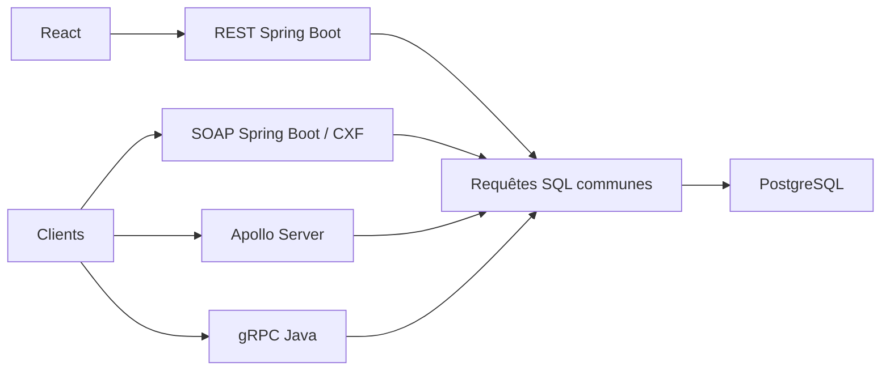

# Contrats et exécution



| API | Adresse locale | Contrat |
|---|---|---|
| REST | `http://localhost:19601/api/reservations` | GET liste/détail, POST, PUT et DELETE |
| SOAP | `http://localhost:19602/ws/hotel?wsdl` | `wsdl/hotel.wsdl`, namespace `http://hotel.imrane.ma/` |
| GraphQL | `http://localhost:19603/graphql` | `graphql-api/schema.graphql` |
| gRPC | `localhost:19605` | `grpc-api/src/main/proto/hotel.proto`, service `hotel.HotelService` |

Les créations/modifications reçoivent `clientId`, `chambreId`, `dateDebut`, `dateFin` et `preferences`. Les réponses incluent aussi le client et la chambre complets. Le fichier `database/queries.json` est partagé entre JDBC et `pg` : création et modification font chacune une écriture puis la même lecture, dans une transaction. Les lectures et suppressions utilisent les mêmes requêtes et le même mode autocommit. Les pools sont limités à 20 connexions.

La base contient initialement 100 clients, 1 000 chambres et une réservation. Les clés étrangères, les dates, la disponibilité et l'exclusion GiST des séjours qui se chevauchent protègent les écritures concurrentes. `evidence/concurrent-rollback.json` montre 20 créations concurrentes sur la même chambre : une seule valide, 19 rejetées, puis nettoyage de la réservation créée.

## Démarrer les conteneurs

```sh
mvn clean verify
docker compose -f compose.yml -f compose-apps.yml up --build -d
```

Le client React est accessible sur `http://localhost:13082`. Chaque serveur fournit `POST /auth/token` avec `student / labpass` ; transmettre ensuite `Authorization: Bearer <token>`. Le JWT HS256 expire après une heure et vérifie signature, algorithme et émetteur. Le client de charge renouvelle son jeton pendant les longues campagnes. Les tests vérifient aussi les jetons absents, falsifiés et expirés.

## TLS et observation

```sh
bash security/create-dev-cert.sh
docker compose -f compose-tls.yml up -d
```

Le proxy Nginx termine TLS sur les ports 19701 (REST), 19702 (SOAP), 19703 (GraphQL) et 19705 (gRPC HTTP/2). Les certificats locaux restent dans `.tls/`, ignoré par Git. Les connexions internes du laboratoire utilisent HTTP ; un déploiement avec plusieurs hôtes doit aussi protéger ce réseau. `evidence/tls-http2.json` conserve les versions/ciphers négociés et de vrais appels authentifiés aux quatre API.

Voir `monitoring/UTILISATION.md` pour Prometheus, Grafana, Jaeger et Elastic Stack, et `k8s/README.md` pour Kubernetes. La comparaison porte sur les phases isolées décrites dans `loadtests/UTILISATION.md` ; les captures fonctionnelles locales servent à vérifier les fonctionnalités.
