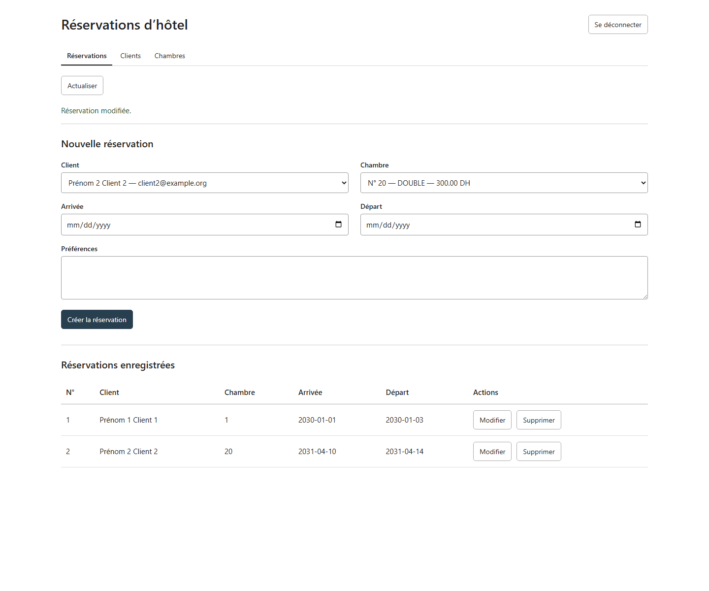
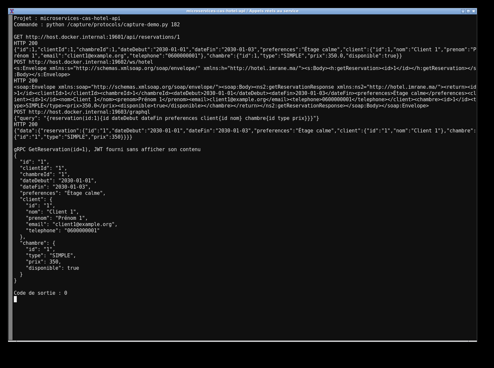
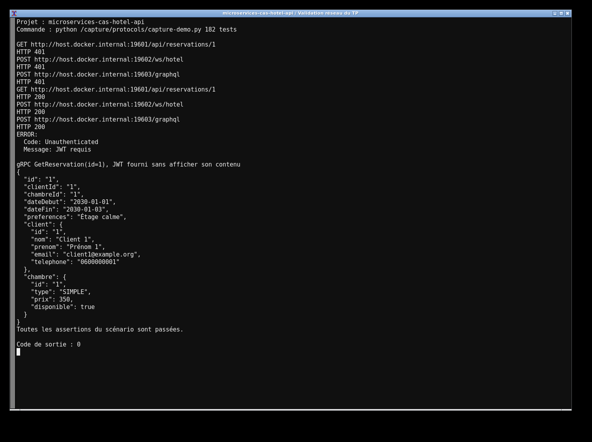

# Étude de cas — Réservations d’hôtel

J’ai repris le même scénario de réservation avec REST, SOAP, GraphQL et gRPC. Les quatre serveurs utilisent PostgreSQL et les mêmes requêtes SQL. Une contrainte empêche deux séjours de se chevaucher dans la même chambre.

```sh
mvn clean verify
docker compose -f compose.yml -f compose-apps.yml up --build -d
```

Le client React s’ouvre sur `http://localhost:13082`. Le compte local est `student / labpass`. Les ports des API sont 19601, 19602, 19603 et 19605. Les contrats WSDL, GraphQL et Protobuf sont inclus, ainsi que les requêtes Postman et SoapUI.

Les tests couvrent le CRUD, les JWT, le rollback concurrent et TLS, avec de vraies captures. La comparaison mesure les messages de 1, 10 et 100 Kio, de 10 à 1 000 utilisateurs, sur quatre runners distincts. Chaque combinaison est répétée trois fois. Les données et l’analyse sont dans `results/`.

Les détails sont dans [ARCHITECTURE.md](ARCHITECTURE.md), les [plans de charge](loadtests/UTILISATION.md), le [déploiement Kubernetes](k8s/README.md) et les [workflows](.github/workflows).




